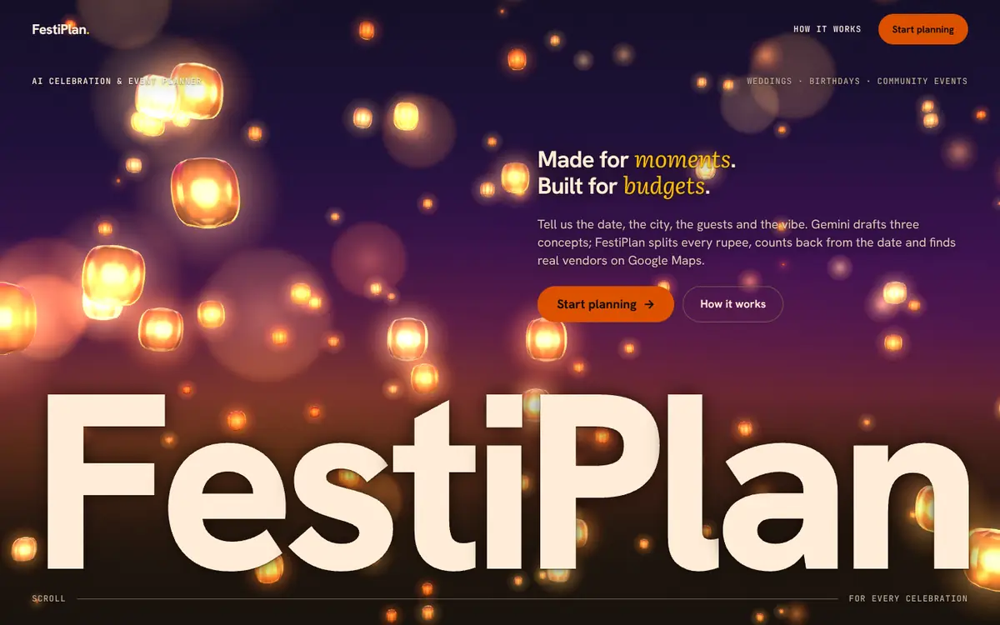
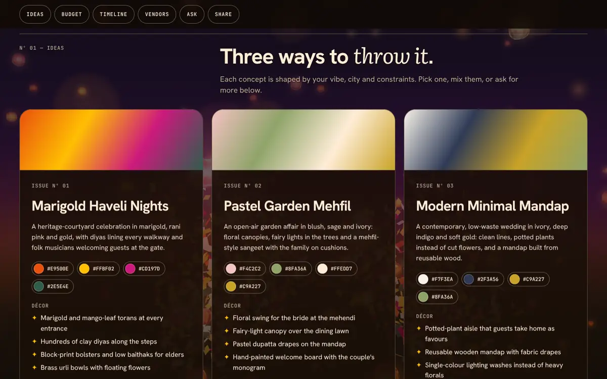
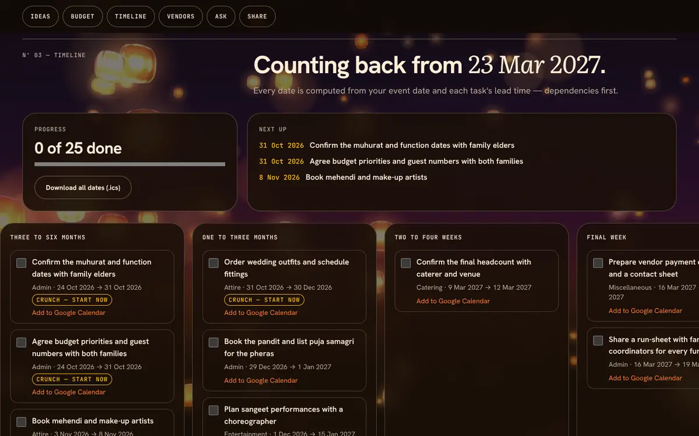
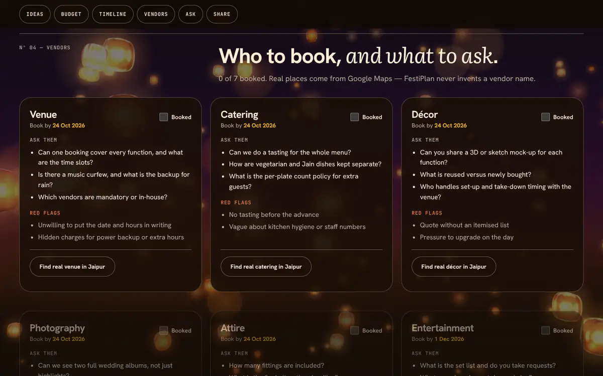
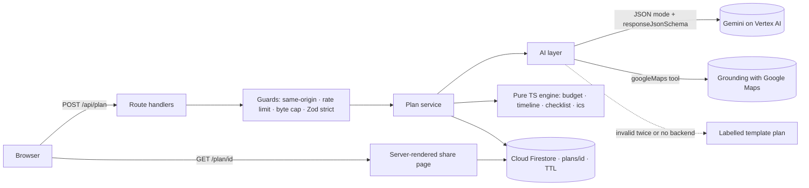

# FestiPlan — AI Celebration & Event Planner

> **Made for moments. Built for budgets.**
> A GenAI planning assistant for Indian weddings, birthdays and community events:
> three personalised concepts, a budget split to the last rupee, a timeline that counts
> back from the date, a vendor checklist and real nearby vendors from Google Maps.

**Live:** https://festiplan-580541627338.us-central1.run.app · **Challenge:** PromptWars — [Challenge 5] Celebration & Event Planner



## Try it in 30 seconds

1. Open the live link and tap **Priya's sangeet · Jaipur · 180 guests · ₹12L**.
2. Watch the staged progress (*Reading the vibe → Drafting concepts → Balancing ₹ → Counting back from the date → Listing who to book*), then the confetti.
3. Drag the **Décor** slider: rupee particles re-flow between the glass columns, every other line re-balances, and the total stays **exactly ₹12,00,000** — no AI call.
4. Tick two timeline tasks, press **Share**, open the read-only link on a phone: the same plan, server-rendered.

## The idea: AI ideates, code calculates

Gemini is excellent at taste and terrible at arithmetic, so FestiPlan never asks it for a
number. The model returns ideas, category **weights**, a task list with **lead times** and
vendor guidance as schema-validated JSON. Every rupee, date, percentage and sort order is
computed by a pure, 100 %-covered TypeScript engine. Vendors are never model-invented:
only places returned by **Grounding with Google Maps** are shown.

| Problem statement | What FestiPlan does | Where |
|---|---|---|
| GenAI-powered planning assistant | Gemini turns a free-text brief into a structured plan; **Ask FestiPlan** streams follow-up advice grounded in the saved plan | [`src/lib/ai/plan.ts`](src/lib/ai/plan.ts), [`refine.ts`](src/lib/ai/refine.ts) |
| weddings | Haldi, mehendi, sangeet, pheras and reception; family roles; "confirm the muhurat with elders" — never an invented auspicious date | [`prompts.ts`](src/lib/ai/prompts.ts), [`templates/wedding.ts`](src/lib/ai/templates/wedding.ts) |
| birthdays | Age-aware themes, kids/adult splits, return gifts | [`templates/birthday.ts`](src/lib/ai/templates/birthday.ts) |
| community events | Festivals and society melas: volunteers, permits, sponsor tiers, stalls, safety, transparent accounts | [`templates/community.ts`](src/lib/ai/templates/community.ts) |
| budgets | Exact largest-remainder split with 10 % contingency, per-guest cost, live re-balancing with locks, planned-vs-actual, overspend alerts | [`src/lib/engine/budget.ts`](src/lib/engine/budget.ts) |
| timelines | Tasks scheduled backwards from the event date with dependencies, phases, crunch/overdue flags, Google Calendar links and `.ics` export | [`timeline.ts`](src/lib/engine/timeline.ts), [`ics.ts`](src/lib/engine/ics.ts) |
| vendor checklists | Book-by dates, questions to ask, red flags, saved tick-offs; real places via Maps grounding | [`checklist.ts`](src/lib/engine/checklist.ts), [`vendors.ts`](src/lib/ai/vendors.ts) |
| personalised ideas | Three distinct concepts (name, palette, décor, menu, music, signature moment) in English or seven Indian languages | [`IdeasSection.tsx`](src/components/plan/IdeasSection.tsx) |

| | |
|---|---|
|  |  |
|  |  |

## Architecture



Details: [`docs/ARCHITECTURE.md`](docs/ARCHITECTURE.md) · product spec: [`docs/SPEC.md`](docs/SPEC.md) · design system: [`docs/DESIGN.md`](docs/DESIGN.md).

## Google services

| Service | Used for | Code |
|---|---|---|
| **Gemini on Vertex AI** (`gemini-3.5-flash`, ADC) | Structured plan generation (JSON mode + schema, low thinking, timeout, one self-correcting retry) and streaming refine | [`client.ts`](src/lib/ai/client.ts), [`plan.ts`](src/lib/ai/plan.ts) |
| **Grounding with Google Maps** | Real nearby venues, caterers and decorators with Maps links; only grounded places are rendered | [`vendors.ts`](src/lib/ai/vendors.ts) |
| **Cloud Firestore** (named Native DB, TTL) | Saved, shareable plans; checklist and actuals; transactional edits; 180-day expiry | [`store/firestore.ts`](src/lib/store/firestore.ts) |
| **Cloud Run** | Hosting the Next.js standalone server; the service identity authenticates to Vertex AI and Firestore — no API keys | [`Dockerfile`](Dockerfile) |
| **Cloud Build + Artifact Registry** | Source deploys from GitHub Actions via Workload Identity Federation | [`deploy.yml`](.github/workflows/deploy.yml) |
| **Cloud Logging** | Structured JSON logs (severity, latency, request id, Gemini token counts; never user text) | [`log.ts`](src/lib/server/log.ts) |

Lighter integrations: **Google Calendar** "Add to Google Calendar" links per task
([`calendar-link.ts`](src/lib/engine/calendar-link.ts)), **Google Maps** search links when grounding
finds nothing, and **Google Fonts** self-hosted at build time via `next/font`.

## Evaluation criteria → evidence

| Criterion | Evidence |
|---|---|
| **Code quality** | TypeScript strict, no `any`, no non-null assertions; every file < 200 lines and every function < 40 lines, **enforced in `npm run lint`** by [`scripts/check-size.mjs`](scripts/check-size.mjs); one contracts module shared by client, server and engine; a lint rule keeps Zod out of the browser bundle |
| **Security** | Nonce-based CSP (no inline scripts), byte caps, strict schemas, same-origin checks, spoof-resistant per-IP rate limits (IPv6 by /64) plus a global AI cap, vendor lookups bound to a stored plan, SHA-256 edit keys with timing-safe comparison, prompt-injection data blocks, CSP + HSTS, deny-all Firestore rules, keyless production — see [`SECURITY.md`](SECURITY.md) |
| **Efficiency** | 160 KB gzip initial JS (113 KB is React + Next itself), 7 KB CSS; memoised chapters so a slider drag re-renders only the header and budget; three.js only in a lazy 135 KB chunk loaded after first paint; canvases pause when hidden; plans cached; vendor lookups cached 24 h — see [`docs/PERFORMANCE.md`](docs/PERFORMANCE.md) |
| **Testing** | **404** unit/component tests; engine at **100 %** and all of `src/lib` at **98 %** line coverage (both enforced thresholds); Playwright e2e on desktop **and** mobile (preset → plan → exact budget → checklist → SSR share page) — see [`docs/TESTING.md`](docs/TESTING.md) |
| **Accessibility** | axe (WCAG 2.0–2.2 A/AA) **zero violations** on `/` and `/plan/[id]` in CI; landmarks, labels, focusable error summary, `aria-live` results, `lang` on AI text in Indian languages, 44 px targets, reduced-motion poster — see [`docs/ACCESSIBILITY.md`](docs/ACCESSIBILITY.md) |
| **Google services** | Gemini on Vertex AI, Maps grounding, Firestore (transactions + TTL), Cloud Run with keyless auth (the bootstrap script creates a least-privilege runtime account), Cloud Build/Artifact Registry via Workload Identity Federation, Cloud Logging — each doing core work |

## Run it locally

```bash
npm ci
cp .env.example .env.local   # optional: add GEMINI_API_KEY; without it you get labelled template plans
npm run dev                  # http://localhost:3000
npm run verify               # lint + size rules + typecheck + tests + production build
npm run test:e2e             # Playwright (desktop + mobile) with axe
```

Production runs on Cloud Run with `GOOGLE_GENAI_USE_VERTEXAI=true` (ADC, no key) and
Firestore; one-time setup is [`scripts/gcp-bootstrap.sh`](scripts/gcp-bootstrap.sh) and every green
push to `main` deploys.

## Project layout

```
src/app            routes (RSC by default), API route handlers, share page, metadata
src/components     client islands: planner form, plan chapters, 3D wrappers
src/lib/contracts  types + Zod schemas shared by everything
src/lib/engine     pure budget / timeline / checklist / ics / particles maths
src/lib/ai         Gemini client, prompts, schema, retry, templates, Maps grounding, refine
src/lib/store      Firestore + in-memory stores behind one interface
src/lib/security   rate limit, body caps, same-origin, edit keys, client IP
src/three          WebGL scenes (lazy, procedural geometry, no model files)
tests/ · e2e/      Vitest suites mirroring src/ · Playwright specs
```

Plans are suggestions — confirm prices, permits and muhurat timings with the people who know them.
