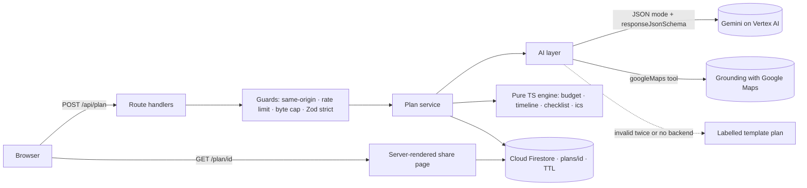

# FestiPlan — AI Celebration & Event Planner

> **Made for moments. Built for budgets.**
> A GenAI planning assistant for Indian weddings, birthdays and community events:
> three personalised concepts, a budget split to the last rupee, a timeline that counts
> back from the date, a vendor checklist and real nearby vendors from Google Maps.

**Live:** https://festiplan-580541627338.us-central1.run.app · **Challenge:** PromptWars — [Challenge 5] Celebration & Event Planner


## Chosen vertical

**[Challenge 5] Celebration & Event Planner**: *"a GenAI-powered planning assistant that
helps users organize weddings, birthdays, and community events with budgets, timelines,
vendor checklists, and personalized ideas."* FestiPlan is built for Indian hosts and
organisers. Its three personas are a family planning a sangeet on a fixed budget, a parent
with two weekends to throw a 7th birthday, and a housing society pooling funds for a Diwali
mela. The three one-tap demo briefs are exactly these people
([`docs/SPEC.md`](docs/SPEC.md) §3).

## Try it in 30 seconds

1. Open the live link and tap **Priya's sangeet · Jaipur · 180 guests · ₹12L**.
2. Watch the staged progress (*Reading the vibe → Drafting concepts → Balancing ₹ → Counting back from the date → Listing who to book*), then the confetti.
3. The plan opens as a workspace on **Overview**: the three concepts, the money, what's next and who to book first — on one screen.
4. Open **Budget** and drag the **Décor** slider: rupee particles re-flow between the glass columns, every other line re-balances, and the total stays **exactly ₹12,00,000** — no AI call.
5. Open **Timeline**, tick two tasks, then **Share** → open the read-only link on a phone: the same plan, server-rendered.

## Approach and logic: AI ideates, code calculates

Gemini is excellent at taste and terrible at arithmetic, so FestiPlan never asks it for a
number. The model returns ideas, category **weights**, a task list with **lead times** and
vendor guidance as schema-validated JSON. Every rupee, date, percentage and sort order is
computed by a pure, 100 %-covered TypeScript engine. Vendors are never model-invented:
only places returned by **Grounding with Google Maps** are shown.

| Problem statement | What FestiPlan does | Where |
|---|---|---|
| GenAI-powered planning assistant | Gemini turns a free-text brief into a structured plan; **Ask FestiPlan** streams follow-up advice grounded in the saved plan | [`src/lib/ai/plan.ts`](src/lib/ai/plan.ts), [`refine.ts`](src/lib/ai/refine.ts) |
| weddings | Haldi, mehendi, sangeet, pheras and reception; family roles; "confirm the muhurat with elders" — never an invented auspicious date | [`prompts.ts`](src/lib/ai/prompts.ts), [`templates/wedding/`](src/lib/ai/templates/wedding/) |
| birthdays | Age-aware themes, kids/adult splits, return gifts | [`templates/birthday/`](src/lib/ai/templates/birthday/) |
| community events | Festivals and society melas: volunteers, permits, sponsor tiers, stalls, safety, transparent accounts | [`templates/community/`](src/lib/ai/templates/community/) |
| budgets | Exact largest-remainder split with 10 % contingency, per-guest cost, live re-balancing with locks, planned-vs-actual, overspend alerts | [`budget.ts`](src/lib/engine/budget.ts), [`budget-edit.ts`](src/lib/engine/budget-edit.ts), [`largest-remainder.ts`](src/lib/engine/largest-remainder.ts) |
| timelines | Tasks scheduled backwards from the event date with dependencies and phases; short lead times compress proportionally so the order holds; overdue flags, Google Calendar links and `.ics` export | [`timeline.ts`](src/lib/engine/timeline.ts), [`compression.ts`](src/lib/engine/compression.ts), [`ics.ts`](src/lib/engine/ics.ts) |
| vendor checklists | Book-by dates, questions to ask, red flags, saved tick-offs; real places via Maps grounding | [`checklist.ts`](src/lib/engine/checklist.ts), [`vendors.ts`](src/lib/ai/vendors.ts) |
| personalised ideas | Three distinct concepts (name, palette, décor, menu, music, signature moment) in English or seven Indian languages | [`IdeasSection.tsx`](src/components/plan/IdeasSection.tsx) |

### How the brief drives each decision

- **Event type** selects the cultural frame for the model and the fallback template: each
  wedding function with family roles (and a note to confirm the muhurat with elders),
  age-aware kids or adult birthdays, and community volunteers, permits, sponsors and
  crowd safety.
- **Budget and guests** turn the model's category weights into exact rupees (largest
  remainder, 10 % contingency) and a per-guest cost. Locks and slider moves re-balance
  the other lines instantly, and the total never drifts.
- **Event date against today** sets the timeline. Tasks are ordered by dependency and
  counted back from the date. When time is short, every lead time shrinks by the same
  factor, so the order still holds; anything already late is flagged as overdue.
- **City** is where Grounding with Google Maps looks for real venues, caterers and
  decorators. The city is read from the saved plan.
- **Vibe and constraints** (dietary, accessibility, eco, cultural) shape the three
  concepts and the tips.
- **Language** sets the language of every AI-written string: English or seven Indian
  languages. That text is marked with `lang` so screen readers pronounce it correctly.

| | |
|---|---|
|  |  |
|  |  |

## How the solution works

1. **Brief.** The form, or a one-tap preset, collects event type, date, city, guests,
   budget (₹), vibe, constraints and language. It is validated in the browser and again on
   the server: same-origin check, rate limit, byte cap, strict Zod schema, and a date
   between tomorrow and three years ahead.
2. **Ideate.** The plan service sends the brief to Gemini on Vertex AI inside a delimited
   data block. JSON mode with a response schema returns three concepts, category weights,
   a task list with lead times and dependencies, and vendor guidance. The reply is
   Zod-validated, with one self-correcting retry. If it still fails, a clearly labelled
   template plan for that event type is used instead.
3. **Calculate.** The pure engine turns weights into exact rupees and schedules every task
   backwards from the date. It also derives vendor book-by dates, progress and the next
   actions.
4. **Store and share.** The plan is saved in Firestore with a 180-day TTL, together with
   only the SHA-256 of a one-time edit key. The owner gets the edit link, which keeps the
   key in the URL fragment. A separate read-only link opens the server-rendered
   `/plan/[id]` page.
5. **Refine.** Slider moves, locks, actual spend and ticks re-run the engine in the browser
   and autosave through one transactional PATCH. **Ask FestiPlan** streams advice
   grounded in the saved plan. **Find vendors** asks Gemini with Maps grounding for real
   places in the plan's city.



Details: [`docs/ARCHITECTURE.md`](docs/ARCHITECTURE.md) · product spec: [`docs/SPEC.md`](docs/SPEC.md) · design system: [`docs/DESIGN.md`](docs/DESIGN.md).

## Assumptions

- Hosts plan in India. Amounts are whole rupees (₹1,000 to ₹50 crore), shown in the Indian
  numbering system (lakh, crore), and vendors are searched in an Indian city.
- Each plan covers one event, with 1 to 5,000 guests and a date from tomorrow up to three
  years ahead.
- Budgets split across ten fixed categories (venue, catering, décor, photography,
  entertainment, attire, invitations, gifts, transport, misc), with 10 % held back as
  contingency.
- Gemini supplies taste and judgement, not facts to rely on. Prices, permits and muhurat
  timings must be confirmed locally, and the model is told never to state an auspicious
  date.
- Collaboration works by sharing links, with no accounts. Whoever holds the edit link can
  edit; the read-only link can be passed around freely. Plans are deleted after 180 days.
- AI-written text can be in English, Hindi, Bengali, Tamil, Telugu, Marathi, Kannada or
  Gujarati. The interface itself is in English.
- If Gemini or Maps grounding is unavailable, the planner keeps working. It uses a
  labelled template plan, and vendor lookups fall back to a Google Maps search link.

## Google services

| Service | Used for | Code |
|---|---|---|
| **Gemini on Vertex AI** (`gemini-3.5-flash`, ADC) | Structured plan generation (JSON mode + schema, low thinking, timeout, one self-correcting retry) and streaming refine | [`client.ts`](src/lib/ai/client.ts), [`plan.ts`](src/lib/ai/plan.ts) |
| **Grounding with Google Maps** | Real nearby venues, caterers and decorators with Maps links; only grounded places are rendered | [`vendors.ts`](src/lib/ai/vendors.ts) |
| **Cloud Firestore** (named Native DB, TTL) | Saved, shareable plans; checklist and actuals; transactional edits; 180-day expiry | [`store/firestore.ts`](src/lib/store/firestore.ts) |
| **Cloud Run** | Hosting the Next.js standalone server; the service identity authenticates to Vertex AI and Firestore — no API keys | [`Dockerfile`](Dockerfile) |
| **Cloud Build + Artifact Registry** | Source deploys from GitHub Actions via Workload Identity Federation | [`deploy.yml`](.github/workflows/deploy.yml) |
| **Cloud Logging** | Structured JSON logs (severity, latency, request id, Gemini token counts; never user text) | [`log.ts`](src/lib/server/log.ts) |

Lighter integrations: **Google Calendar** "Add to Google Calendar" links per task
([`calendar-link.ts`](src/lib/engine/calendar-link.ts)), **Google Maps** search links when grounding
finds nothing, and **Google Fonts** self-hosted at build time via `next/font`.

## Evaluation criteria → evidence

| Criterion | Evidence |
|---|---|
| **Code quality** | TypeScript strict, no `any`, no non-null assertions. **Prettier** formatting, **typescript-eslint `strictTypeChecked` + `stylisticTypeChecked`** with full type information, and **jsx-a11y `strict`**, all enforced in CI. Every TypeScript file < 200 lines and every function in `src/` < 40 lines, **enforced in `npm run lint`** by [`scripts/check-size.mjs`](scripts/check-size.mjs). One contracts module is shared by client, server and engine, and a lint rule keeps Zod out of the browser bundle. See [`CONTRIBUTING.md`](CONTRIBUTING.md) |
| **Security** | Nonce-based CSP with no `'unsafe-inline'` at all (scripts and styles both need the per-request nonce; pages ship no `style` attributes), byte caps, strict schemas, same-origin checks, spoof-resistant per-IP rate limits (IPv6 by /64) plus a global AI cap, vendor lookups bound to a stored plan, SHA-256 edit keys with timing-safe comparison, prompt-injection data blocks, HSTS/COOP/CORP headers, deny-all Firestore rules, keyless production. Supply chain: SHA-pinned GitHub Actions, **CodeQL** on the code and the workflows, a CI gate on production-dependency advisories, and deploys only from pushes to `main`. See [`SECURITY.md`](SECURITY.md) |
| **Efficiency** | 163 KB gzip initial JS (114 KB is React + Next itself), 8.4 KB CSS; memoised chapters so a slider drag re-renders only the header and budget; three.js only in a lazy 135 KB chunk loaded after first paint; canvases pause when hidden; plans cached; vendor lookups cached 24 h — see [`docs/PERFORMANCE.md`](docs/PERFORMANCE.md) |
| **Testing** | **593** unit/component tests in 78 files; engine at **100 %** (statements, branches, functions, lines) and all of `src/lib` at **98.8 %** line coverage (both enforced thresholds); **38** Playwright e2e runs on desktop **and** mobile (preset → plan → exact budget → checklist → SSR share page, axe on every tab, SEO, crawl files, and CSP violation checks), stable over `--repeat-each=3` — see [`docs/TESTING.md`](docs/TESTING.md) |
| **Accessibility** | axe (WCAG 2.0–2.2 A/AA) **zero violations** on `/` and every tab of `/plan/[id]` in CI, plus **jsx-a11y `strict`** lint; WAI-ARIA tabs with arrow/Home/End keys, landmarks and a skip link, labels, focusable error summary, `aria-live` results, `lang` on AI text in Indian languages, 44 px targets, reduced-motion poster, Windows High Contrast (`forced-colors`) support — see [`docs/ACCESSIBILITY.md`](docs/ACCESSIBILITY.md) |
| **Google services** | Gemini on Vertex AI, Maps grounding, Firestore (transactions + TTL), Cloud Run with keyless auth (the bootstrap script creates a least-privilege runtime account), Cloud Build/Artifact Registry via Workload Identity Federation, Cloud Logging — each doing core work |

## Run it locally

```bash
npm ci
cp .env.example .env.local   # optional: add GEMINI_API_KEY; without it you get labelled template plans
npm run dev                  # http://localhost:3000
npm run format               # Prettier
npm run verify               # format check + lint (ESLint + size rules) + typecheck + tests + production build
npm run test:e2e             # Playwright (desktop + mobile) with axe
```

Production runs on Cloud Run with `GOOGLE_GENAI_USE_VERTEXAI=true` (ADC, no key) and
Firestore; one-time setup is [`scripts/gcp-bootstrap.sh`](scripts/gcp-bootstrap.sh) and every green
push to `main` deploys.

## Project layout

```
src/app            routes (RSC by default), API route handlers, share page, metadata
src/components     client islands: planner form, plan chapters, 3D wrappers
src/lib/contracts  types + Zod schemas shared by everything
src/lib/engine     pure budget / timeline / checklist / ics / particles maths
src/lib/ai         Gemini client, prompts, schema, retry, templates, Maps grounding, refine
src/lib/store      Firestore + in-memory stores behind one interface
src/lib/security   rate limit, body caps, same-origin, edit keys, client IP
src/three          WebGL scenes (lazy, procedural geometry, no model files)
tests/ · e2e/      Vitest suites mirroring src/ · Playwright specs
```

## Contributing and security

Workflow, code style and the definition of done are in [`CONTRIBUTING.md`](CONTRIBUTING.md).
The threat model, the controls and how to report a vulnerability are in [`SECURITY.md`](SECURITY.md).

Plans are suggestions — confirm prices, permits and muhurat timings with the people who know them.
